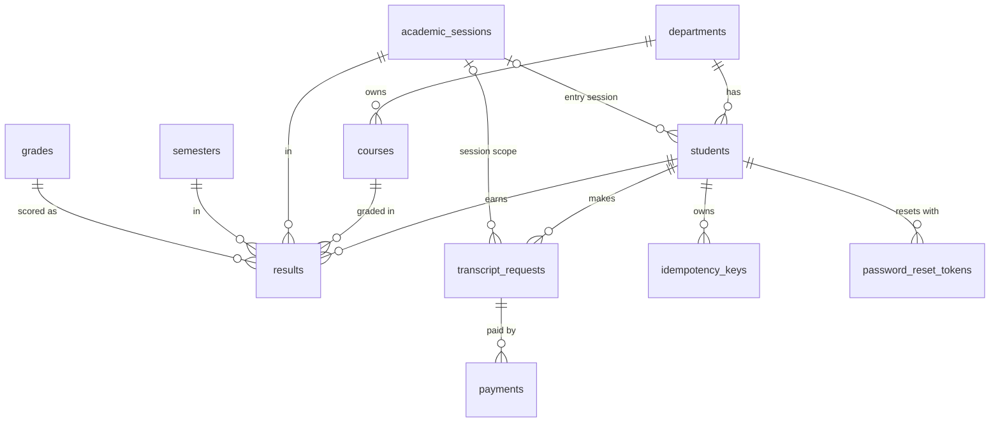

# DATABASE_SCHEMA.md

**Group 12: Digital Examination Result and Transcript Payment System**

| | |
|---|---|
| **Status** | Schema v1.1 (migrations 003 and 004 applied), awaiting Backend sign-off (Gate G1) |
| **Owner** | Database team |
| **Engine** | MySQL 8.0.16+ / MariaDB 10.4+ (XAMPP), InnoDB, `utf8mb4` |
| **Database name** | `transcript_system` |
| **Source of truth** | `database/001_schema.sql` plus the later migrations (`003_*.sql`, ...). If this document and the SQL disagree, the SQL wins; fix this document. |

---

## 1. Setup

1. Start MySQL in XAMPP and open phpMyAdmin.
2. Import, in this order:
   1. `database/001_schema.sql` (creates the database, 10 tables, 4 views)
   2. `database/002_seed_data.sql` (fake data)
   3. `database/003_backend_alignment.sql` (adds the contract's statuses, destination fields and 3 new tables; 13 tables in total)
   4. `database/004_seed_update.sql` (fake data for the new states)
3. To rebuild from scratch: `DROP DATABASE transcript_system;` and import all four files again, in order. Migrations are not re-runnable on an existing database.

Works on MySQL 8 and on XAMPP's MariaDB 10.4+.

Schema changes after this point go in new numbered files (`003_*.sql`, `004_*.sql`, ...) and are announced to everyone. Never edit a merged SQL file.

### Test logins (from the seed data)

| Who | Login | Password |
|---|---|---|
| Students | matric number, e.g. `CSC/2023/001` | `Test@1234` |
| Admins | `registry.admin` or `finance.admin` | `Admin@1234` |

`CSC/2024/003` is a suspended account (cannot log in). Passwords are stored as bcrypt hashes made with PHP `password_hash()`; verify with `password_verify()`.

---

## 2. Entity overview

| # | Table | Purpose | Features covered |
|---|-------|---------|------------------|
| 1 | `departments` | Departments that students and courses belong to | Student profile |
| 2 | `academic_sessions` | Sessions such as `2025/2026` | Semester selection |
| 3 | `semesters` | `First Semester`, `Second Semester` | Semester selection |
| 4 | `grades` | Grade scale (A to F with grade points) | GPA calculation |
| 5 | `admins` | Administrator accounts (separate from students) | Admin dashboard |
| 6 | `students` | Student accounts and profile | Login, profile |
| 7 | `courses` | Course catalogue (code, title, unit) | Result retrieval |
| 8 | `results` | One row per student, course, session and semester | Result retrieval, GPA |
| 9 | `transcript_requests` | A transcript request, its status, fee, and the issued transcript record | Request, fee, status, download/print |
| 10 | `payments` | Payment attempts against a request | Payment, verification |
| 11 | `idempotency_keys` | Stored responses for repeated create/pay calls | Duplicate-submit protection |
| 12 | `login_attempts` | Failed and successful login/reset attempts | Rate limiting |
| 13 | `password_reset_tokens` | Hashed one-time reset tokens | Password reset |

Plus 4 views (section 6) for GPA, CGPA and payment status.

### ERD



`students` and `courses` are many-to-many, resolved through `results`, which also carries the session, semester and grade. `admins` and `login_attempts` stand alone: admins log in separately and no table references them.

### OOP class to table mapping

| PHP class | Main table(s) |
|-----------|---------------|
| `Student` | `students`, `departments` |
| `Course` | `courses` |
| `Result` | `results`, `grades`, `academic_sessions`, `semesters` |
| `Transcript` | `transcript_requests` |
| `Payment` | `payments` |
| `Database` | PDO connection only (no table) |

### Configuration (not stored in the database)

Site-wide values live in a settings file in the PHP project, not in a table:

| Setting | Example | Used for |
|---|---|---|
| `TRANSCRIPT_FEE` | `5000.00` | Per-copy fee; the computed total is copied into `transcript_requests.fee_amount` when a request is created |
| `CURRENCY` | `NGN` | Payments |
| `UNIVERSITY_NAME` | `University of Ibadan` | Transcript header |
| `CURRENT_SESSION` | `2025/2026` | Default session; Backend must check it exists in `academic_sessions` |
| `COURIER_SURCHARGE` | to be agreed | Added to the fee for courier delivery (fee = `TRANSCRIPT_FEE` x copies + surcharge; formula to be agreed by the group) |
| `REQUEST_PAYMENT_HOURS` | `24` | Payment deadline: stored as `transcript_requests.expires_at` at creation |
| `PAYMENT_MODE` | `simulated` | `simulated` or `paystack`. Backend must refuse simulated payments when this is not `simulated`. |
| `QUOTE_SECRET` | random string, never committed | Signs the fee quote so `create.php` can trust `quoteExpiresAt` |

---

## 3. Conventions

- Primary keys: `id INT UNSIGNED AUTO_INCREMENT` (except `grades`, keyed by the grade letter).
- Every `*_id` foreign key has the same type as the parent `id`.
- `created_at`: `DATETIME NOT NULL DEFAULT CURRENT_TIMESTAMP`.
- `updated_at`: `DATETIME NOT NULL DEFAULT CURRENT_TIMESTAMP ON UPDATE CURRENT_TIMESTAMP`.
- Money is `DECIMAL(10,2)` in naira. Paystack works in kobo, so convert (x100) at the gateway boundary only.

---

## 4. Table definitions

### 4.1 departments

| Column | Type | Constraints | Notes |
|---|---|---|---|
| id | INT UNSIGNED | PK | |
| code | VARCHAR(10) | NOT NULL, UNIQUE | e.g. `CSC` |
| name | VARCHAR(120) | NOT NULL | e.g. Computer Science |
| faculty | VARCHAR(120) | NOT NULL | e.g. Faculty of Computing |

### 4.2 academic_sessions

| Column | Type | Constraints | Notes |
|---|---|---|---|
| id | INT UNSIGNED | PK | |
| name | VARCHAR(9) | NOT NULL, UNIQUE, CHECK format `NNNN/NNNN` | e.g. `2025/2026` |

The current session is not flagged here; it comes from `CURRENT_SESSION` in the settings file.

### 4.3 semesters

| Column | Type | Constraints | Notes |
|---|---|---|---|
| id | INT UNSIGNED | PK | |
| name | VARCHAR(20) | NOT NULL, UNIQUE | `First Semester` / `Second Semester` |
| sort_order | TINYINT UNSIGNED | NOT NULL, UNIQUE | 1, 2. Used to order terms. |

A lookup table (not free text) keeps the spelling identical in the database, the API and the pages.

### 4.4 grades

| Column | Type | Constraints | Notes |
|---|---|---|---|
| grade | CHAR(1) | PK | A to F |
| grade_point | DECIMAL(2,1) | NOT NULL | A=5.0 ... F=0.0 |
| min_score | DECIMAL(5,2) | NOT NULL | Lower bound of the score band |
| max_score | DECIMAL(5,2) | NOT NULL, CHECK min_score <= max_score | Upper bound |

Assumed scale (to confirm with the department): A 70-100 (5), B 60-69 (4), C 50-59 (3), D 45-49 (2), E 40-44 (1), F 0-39 (0).

### 4.5 admins

| Column | Type | Constraints | Notes |
|---|---|---|---|
| id | INT UNSIGNED | PK | |
| username | VARCHAR(50) | NOT NULL, UNIQUE | Admin login |
| full_name | VARCHAR(150) | NOT NULL | |
| email | VARCHAR(120) | NULL, UNIQUE | |
| password_hash | VARCHAR(255) | NOT NULL | `password_hash()` output only |
| is_active | TINYINT(1) | NOT NULL, DEFAULT 1 | Deactivate instead of deleting |
| last_login_at | DATETIME | NULL | |
| created_at / updated_at | DATETIME | | See conventions |

Admins and students are separate account types. An admin cannot be a student and has a separate login and session. There is one kind of admin; no roles.

### 4.6 students

| Column | Type | Constraints | Notes |
|---|---|---|---|
| id | INT UNSIGNED | PK | |
| matric_no | VARCHAR(20) | NOT NULL, UNIQUE | Login ID, e.g. `CSC/2023/001`. Store uppercase. |
| full_name | VARCHAR(150) | NOT NULL | |
| email | VARCHAR(120) | NOT NULL, UNIQUE | |
| phone | VARCHAR(20) | NULL | |
| date_of_birth | DATE | NULL | Printed on transcript |
| department_id | INT UNSIGNED | NOT NULL, FK to departments.id | |
| level | SMALLINT UNSIGNED | NOT NULL, CHECK 100 to 600 | |
| entry_session_id | INT UNSIGNED | NULL, FK to academic_sessions.id | Admission session, printed on transcript |
| password_hash | VARCHAR(255) | NOT NULL | `password_hash()` output only |
| status | ENUM('active','suspended','graduated') | NOT NULL, DEFAULT 'active' | Suspended accounts cannot log in |
| last_login_at | DATETIME | NULL | |
| created_at / updated_at | DATETIME | | See conventions |

Index: `idx_students_department (department_id)`.

### 4.7 courses

| Column | Type | Constraints | Notes |
|---|---|---|---|
| id | INT UNSIGNED | PK | |
| code | VARCHAR(10) | NOT NULL, UNIQUE | e.g. `CSC 204` (with a space, everywhere) |
| title | VARCHAR(150) | NOT NULL | |
| unit | TINYINT UNSIGNED | NOT NULL, CHECK 1 to 10 | |
| department_id | INT UNSIGNED | NOT NULL, FK to departments.id | Owning department |

Index: `idx_courses_department (department_id)`.

### 4.8 results

| Column | Type | Constraints | Notes |
|---|---|---|---|
| id | INT UNSIGNED | PK | |
| student_id | INT UNSIGNED | NOT NULL, FK to students.id | |
| course_id | INT UNSIGNED | NOT NULL, FK to courses.id | |
| session_id | INT UNSIGNED | NOT NULL, FK to academic_sessions.id | |
| semester_id | INT UNSIGNED | NOT NULL, FK to semesters.id | |
| score | DECIMAL(5,2) | NULL, CHECK 0 to 100 | Optional raw score |
| grade | CHAR(1) | NOT NULL, FK to grades.grade | |
| created_at / updated_at | DATETIME | | See conventions |

Constraints and indexes:

- `UNIQUE uq_result (student_id, course_id, session_id, semester_id)`: no duplicate result for the same course in the same session and semester.
- `INDEX idx_results_lookup (student_id, session_id, semester_id)`: serves the asynchronous results request.
- `INDEX idx_results_course (course_id)`.

Results come from seed data; there is no admin upload feature.

### 4.9 transcript_requests (request and issued transcript)

The issued-transcript columns (`transcript_no`, `total_units`, `gpa`, `cgpa`, `ready_at`, `sent_at`) stay NULL until the request is `ready` or `sent`.

| Column | Type | Constraints | Notes |
|---|---|---|---|
| id | INT UNSIGNED | PK | Public id is `tr_` + id |
| request_no | VARCHAR(20) | NOT NULL, UNIQUE | Human-friendly, e.g. `TR-2026-000001` |
| student_id | INT UNSIGNED | NOT NULL, FK to students.id | |
| status | ENUM (10 values) | NOT NULL, DEFAULT 'pending_payment' | `pending_payment`, `payment_processing`, `paid`, `processing`, `ready`, `sent`, `failed`, `cancelled`, `rejected`, `expired`. See section 8. |
| scope | ENUM('full','session') | NOT NULL, DEFAULT 'full' | Backend always writes `full`. `session` is reserved and unused by the API. |
| session_id | INT UNSIGNED | NULL, FK to academic_sessions.id | Only when scope = `session` |
| destination_type | ENUM('personal','institution') | NOT NULL, DEFAULT 'personal' | |
| institution_name | VARCHAR(150) | NULL | Required for institution requests |
| destination_address | VARCHAR(255) | NULL | Required when delivery is `courier` |
| destination_email | VARCHAR(120) | NULL | Required when delivery is `email` |
| delivery_method | ENUM('download','email','courier') | NOT NULL, DEFAULT 'download' | Personal = `download`; institution = `email` or `courier` |
| copies | TINYINT UNSIGNED | NOT NULL, DEFAULT 1, CHECK 1 to 3 | |
| fee_amount | DECIMAL(10,2) | NOT NULL, CHECK > 0 | Total fee computed by Backend at creation (whole naira; API returns an integer) |
| purpose | VARCHAR(255) | NULL | Optional reason |
| rejection_reason | VARCHAR(255) | NULL | Required (by CHECK) when status = `rejected` |
| expires_at | DATETIME | NULL | Payment deadline for an unpaid request; Backend expires lazily |
| open_student_id | INT UNSIGNED | GENERATED VIRTUAL | `student_id` while status is `pending_payment`, `payment_processing`, `failed`, `paid` or `processing`, otherwise NULL |
| ready_at | DATETIME | NULL | When the transcript was issued |
| sent_at | DATETIME | NULL | When an institution copy was dispatched |
| transcript_no | VARCHAR(25) | NULL, UNIQUE | Printed on the document |
| total_units | SMALLINT UNSIGNED | NULL | Snapshot at issue; counts every row included |
| gpa | DECIMAL(3,2) | NULL | Reserved (session scope only) |
| cgpa | DECIMAL(3,2) | NULL | Overall CGPA at issue |
| download_count | INT UNSIGNED | NOT NULL, DEFAULT 0 | |
| last_downloaded_at | DATETIME | NULL | |
| created_at / updated_at | DATETIME | | See conventions |

CHECK constraints:

| Name | Rule |
|---|---|
| `chk_req_fee` | `fee_amount > 0` |
| `chk_req_scope` | `scope = 'full'` needs no `session_id`; `scope = 'session'` needs one |
| `chk_req_copies` | `copies` between 1 and 3 |
| `chk_req_destination` | Personal means download and no institution fields. Institution needs a name, plus an email for `email` delivery or an address for `courier` delivery. |
| `chk_req_issued` | `ready` and `sent` need `transcript_no`, `total_units`, `cgpa` and `ready_at` |
| `chk_req_ready_personal` | `ready` only for personal copies |
| `chk_req_sent` | `sent` only for institution copies, and needs `sent_at` |
| `chk_req_rejected` | `rejected` needs `rejection_reason` |

Indexes:

- `UNIQUE uq_one_open_request (open_student_id)`: a student cannot have a second open request, whatever the destination. Closed requests (`ready`, `sent`, `cancelled`, `rejected`, `expired`) have NULL here, and NULLs do not collide.
- `UNIQUE uq_request_no`, `UNIQUE uq_transcript_no` (NULL transcript numbers do not collide).
- `idx_req_student (student_id, status)`, `idx_req_status (status, created_at)`.

Only the current status is stored; there is no status-history table.

### 4.10 payments

| Column | Type | Constraints | Notes |
|---|---|---|---|
| id | INT UNSIGNED | PK | |
| request_id | INT UNSIGNED | NOT NULL, FK to transcript_requests.id | A request can have several attempts |
| reference | VARCHAR(50) | NOT NULL, UNIQUE | Our payment reference, unique per attempt |
| gateway | ENUM('paystack','simulated') | NOT NULL, DEFAULT 'simulated' | `simulated` is the demo mode |
| gateway_txn_id | VARCHAR(100) | NULL | Gateway transaction id, from the verify response |
| amount | DECIMAL(10,2) | NOT NULL, CHECK > 0 | Naira. Backend checks it equals `fee_amount`. |
| currency | CHAR(3) | NOT NULL, DEFAULT 'NGN' | |
| status | ENUM('initiated','success','failed','cancelled') | NOT NULL, DEFAULT 'initiated' | |
| failure_reason | VARCHAR(255) | NULL | |
| raw_response | JSON | NULL | Gateway or verify payload, for debugging |
| initiated_at | DATETIME | NOT NULL, DEFAULT CURRENT_TIMESTAMP | |
| paid_at | DATETIME | NULL | When the payer completed payment |
| verified_at | DATETIME | NULL | Set only after backend verification passes |
| receipt_no | VARCHAR(20) | NULL, UNIQUE | e.g. `RCPT-2026-1001`; set when the payment is verified |
| refunded_at | DATETIME | NULL | Set if a paid request is later refunded (status stays `success`, so one-success rule still holds) |
| success_flag | TINYINT | GENERATED VIRTUAL | 1 when status = `success`, otherwise NULL |

Constraints and indexes:

- `UNIQUE uq_payment_ref (reference)`, `UNIQUE uq_receipt_no (receipt_no)`.
- `UNIQUE uq_one_success (request_id, success_flag)`: any number of failed attempts, but at most one successful payment per request.
- `idx_pay_request (request_id)`, `idx_pay_status (status, paid_at)`.

**Flow:** `pay.php` inserts an `initiated` row with a unique reference and moves the request to `payment_processing`. In simulated mode the verify step marks the payment successful; in Paystack mode Backend calls Paystack's verify API with the reference. Either way, only if the status is `success` and the amount matches `fee_amount` does Backend set `status = 'success'`, `paid_at`, `verified_at` and `receipt_no`, and move the request to `paid`. Verification must be safe to call twice, and must never run on a browser redirect alone. Revenue is `SUM(amount)` where `status = 'success'` and `refunded_at IS NULL`.

### 4.11 idempotency_keys

Used by `transcripts/create.php` and `transcripts/pay.php`. Same key and same body returns the stored response; same key with a different body returns `409 idempotency_conflict`.

| Column | Type | Constraints | Notes |
|---|---|---|---|
| id | INT UNSIGNED | PK | |
| student_id | INT UNSIGNED | NOT NULL, FK to students.id | ON DELETE CASCADE |
| endpoint | VARCHAR(100) | NOT NULL | Include the resource, e.g. `transcripts/pay:5` |
| idem_key | VARCHAR(100) | NOT NULL | The `Idempotency-Key` header value (`key` is a reserved word) |
| request_hash | CHAR(64) | NOT NULL | SHA-256 of the request body |
| response_status | SMALLINT UNSIGNED | NULL | NULL while the first request is still running |
| response_body | JSON | NULL | |
| created_at | DATETIME | NOT NULL, DEFAULT CURRENT_TIMESTAMP | |

`UNIQUE uq_idem (student_id, endpoint, idem_key)`, `idx_idem_created (created_at)` for cleanup.

### 4.12 login_attempts

| Column | Type | Constraints | Notes |
|---|---|---|---|
| id | BIGINT UNSIGNED | PK | |
| kind | ENUM('login','reset') | NOT NULL, DEFAULT 'login' | |
| identifier | VARCHAR(120) | NOT NULL | Uppercase matric number, or the email for a reset request |
| ip_address | VARCHAR(45) | NOT NULL | |
| success | TINYINT(1) | NOT NULL, DEFAULT 0 | |
| attempted_at | DATETIME | NOT NULL, DEFAULT CURRENT_TIMESTAMP | |

Suggested rule: 5 failed attempts per 15 minutes per identifier and IP, then `429 rate_limited` with `Retry-After`. Delete rows older than a day when convenient.

### 4.13 password_reset_tokens

| Column | Type | Constraints | Notes |
|---|---|---|---|
| id | INT UNSIGNED | PK | |
| student_id | INT UNSIGNED | NOT NULL, FK to students.id | ON DELETE CASCADE |
| token_hash | CHAR(64) | NOT NULL, UNIQUE | SHA-256 of the token; the token itself is never stored |
| expires_at | DATETIME | NOT NULL | Short-lived (e.g. 1 hour) |
| used_at | DATETIME | NULL | Set when used |
| ip_address | VARCHAR(45) | NULL | |
| created_at | DATETIME | NOT NULL, DEFAULT CURRENT_TIMESTAMP | |

Single use: Backend runs `UPDATE ... SET used_at = NOW() WHERE token_hash = ? AND used_at IS NULL AND expires_at > NOW()` and checks that exactly one row changed. On XAMPP there is no mail server, so the reset link is written to a log file instead of being emailed.

---

## 5. Relationships and delete rules

| Parent (1) | Child (N) | Via | ON DELETE | ON UPDATE |
|---|---|---|---|---|
| departments | students | students.department_id | RESTRICT | CASCADE |
| departments | courses | courses.department_id | RESTRICT | CASCADE |
| academic_sessions | students | students.entry_session_id | SET NULL | CASCADE |
| students | results | results.student_id | RESTRICT | CASCADE |
| courses | results | results.course_id | RESTRICT | CASCADE |
| academic_sessions | results | results.session_id | RESTRICT | CASCADE |
| semesters | results | results.semester_id | RESTRICT | CASCADE |
| grades | results | results.grade | RESTRICT | CASCADE |
| students | transcript_requests | transcript_requests.student_id | RESTRICT | RESTRICT |
| academic_sessions | transcript_requests | transcript_requests.session_id | RESTRICT | RESTRICT |
| transcript_requests | payments | payments.request_id | RESTRICT | CASCADE |
| students | idempotency_keys | idempotency_keys.student_id | CASCADE | CASCADE |
| students | password_reset_tokens | password_reset_tokens.student_id | CASCADE | CASCADE |

**Rationale:** financial and academic records are never silently deleted (RESTRICT). Short-lived technical rows (idempotency keys, reset tokens) go with their student. The two `transcript_requests` keys use `ON UPDATE RESTRICT` because MySQL and MariaDB refuse a CHECK constraint or generated column on a column whose foreign key has a cascading action. Ids never change, so nothing is lost.

---

## 6. Views (derived data)

Formula: `GPA = SUM(unit x grade_point) / SUM(unit)`.

| View | What it gives |
|---|---|
| `v_result_details` | One row per result with matric number, session, semester, course, unit, grade, grade point and quality points |
| `v_semester_gpa` | Total units, total points and GPA per student, session and semester |
| `v_request_latest_payment` | Each request with its most recent payment's status and dates |
| `v_counted_results` | `v_result_details` minus superseded attempts: when a course was taken more than once, only the latest attempt counts |

**Important: CGPA as of a given semester.** `v_counted_results` considers every attempt the student has ever made, including later ones. Use it only for the overall CGPA (for example the snapshot stored on an issued transcript). For the CGPA shown on the results page "up to and including" the selected semester, Backend must compute it from `v_result_details`, keeping only rows at or before that semester and then only the latest attempt per course within those rows. Example: for `CSC/2023/001` at 2024/2025 Second Semester, `v_counted_results` gives 4.30 (the failed CSC 204 is hidden by a later retake), while the correct cumulative CGPA at that point is 3.98.

- **Semester GPA** uses the rows of that semester (`v_semester_gpa`).
- **Attempt numbers** use `ROW_NUMBER() OVER (PARTITION BY student_id, code ORDER BY session, sort_order)`, which works on MySQL 8 and MariaDB 10.2+.

Admin dashboard queries need no extra tables:

```sql
-- Requests by status
SELECT status, COUNT(*) FROM transcript_requests GROUP BY status;
-- Revenue (verified, not refunded)
SELECT SUM(amount) FROM payments WHERE status = 'success' AND refunded_at IS NULL;
-- Pending payments
SELECT * FROM transcript_requests WHERE status IN ('pending_payment', 'payment_processing');
```

---

## 7. Business rules the schema enforces

| Rule | Enforced by |
|---|---|
| No duplicate result for a course in the same session and semester | `uq_result` |
| A result must reference a real student, course, session, semester and grade | Foreign keys |
| Consistent session and semester naming | `academic_sessions` and `semesters` lookups |
| Unique matric number, email, course code, payment reference, request number, receipt number | UNIQUE keys |
| Only one successful payment per request | `uq_one_success` (generated column) |
| Only one open transcript request per student | `uq_one_open_request` (generated column) |
| Valid destination and delivery combinations, 1 to 3 copies | CHECK on `transcript_requests` |
| An issued (`ready` or `sent`) request always has its transcript number, units, CGPA and ready time | CHECK on `transcript_requests` |
| A rejected request always has a reason | CHECK on `transcript_requests` |
| Status values limited to the agreed list | ENUM |
| Fee at request time is preserved | `transcript_requests.fee_amount` |
| One response per idempotency key | `uq_idem` |
| A reset token hash is never reused | `uq_reset_token_hash` |
| Score within 0 to 100, unit within 1 to 10, level within 100 to 600 | CHECK |
| Passwords never stored in plain text | `password_hash` columns hold `password_hash()` output (convention) |

## 8. Business rules enforced by Backend, not the schema

- A student sees only their own data (student id comes from the session, never from the browser). Another student's resource id returns 404.
- Fee and quote: the server recomputes the fee at create time. The quote is signed (`QUOTE_SECRET`), so `quoteExpiresAt` cannot be forged. The quote only limits how long the student has to submit; the request then has its own payment deadline (`expires_at`).
- Payment amount and status are decided on the server; the amount must equal `fee_amount`. Simulated payment is refused unless `PAYMENT_MODE` is `simulated`.
- Status transitions follow the table below; every other transition returns `409 invalid_transition`. The database stores only the current status, so test transitions carefully.
- Expiry is lazy: when a request is read or paid and its deadline has passed, Backend marks it `expired`. A `payment_processing` request that stays unsettled for about 30 minutes moves to `failed`, so the student can retry or cancel.
- Download only for the owner, status `ready`, personal copy. `sent` (institution) copies never offer download.
- A session-scoped request is not offered by the API (`scope` is always `full`).
- A paid request that is later rejected needs a refund: set `payments.refunded_at`. The student can then make a new request.
- Suspended students cannot log in; deactivated admins cannot log in.

### Request status values

| Status | Meaning | Open? |
|---|---|---|
| `pending_payment` | Created, fee not yet paid | yes |
| `payment_processing` | Payment started, not yet verified | yes |
| `failed` | Payment failed or operational failure; needs a next step | yes |
| `paid` | Payment verified | yes |
| `processing` | Registry is preparing it | yes |
| `ready` | Personal copy issued; download allowed | no |
| `sent` | Institution copy dispatched | no |
| `cancelled` | Student cancelled before paying | no |
| `rejected` | Refused by Registry (reason recorded) | no |
| `expired` | Unpaid request passed its deadline | no |

### Allowed transitions

| From | To | Triggered by |
|---|---|---|
| pending_payment | payment_processing | student starts payment |
| pending_payment | cancelled | student cancels |
| pending_payment | expired | deadline passed (lazy) |
| payment_processing | paid | verification succeeds |
| payment_processing | failed | verification fails, or unsettled after about 30 minutes |
| failed | payment_processing | student retries payment |
| failed | cancelled | student cancels |
| failed | expired | deadline passed (lazy) |
| paid | processing | admin |
| paid, processing | rejected | admin (reason required) |
| processing | ready | admin, personal copy (sets transcript number and snapshot) |
| processing | sent | admin, institution copy |

---

## 9. Seed data summary (`002_seed_data.sql` and `004_seed_update.sql`)

| Table | Rows |
|---|---|
| departments | 4 |
| academic_sessions | 4 (2022/2023 to 2025/2026) |
| semesters | 2 |
| grades | 6 |
| courses | 18 |
| admins | 2 |
| students | 8 |
| results | 85 |
| transcript_requests | 11 (every status is represented; see below) |
| payments | 8 (5 success, 2 failed, 1 initiated) |
| idempotency_keys, login_attempts, password_reset_tokens | 0 |

Request coverage: `ready` (2), `pending_payment`, `payment_processing`, `paid`, `processing`, `rejected`, `sent` (institution, email, 2 copies), `cancelled`, `expired`, `failed`. Fees are placeholders (5,000 per copy) until the group agrees the formula.

Edge cases: `CSC/2023/001` (the brief's example, CSC 204 grade A in 2025/2026 Second Semester) failed CSC 204 earlier and retook it; `CSC/2023/002` has no 2025/2026 Second Semester results; `CSC/2025/002` has no results at all; `CSC/2024/003` is suspended.

## 10. Change process

1. Ask the Database team for any new column or table.
2. Changes go in a new numbered file (`005_add_xxx.sql`) and are announced to everyone.
3. Update this document in the same pull request.
4. Never edit an SQL file after it has been merged.