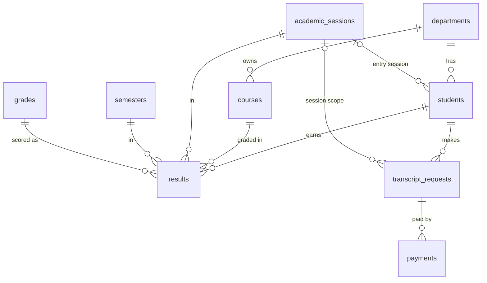

# DATABASE_SCHEMA.md

**Group 12: Digital Examination Result and Transcript Payment System**

| | |
|---|---|
| **Status** | Schema v1, awaiting Backend sign-off (Gate G1) |
| **Owner** | Database team |
| **Engine** | MySQL 8.0.16+ / MariaDB 10.4+ (XAMPP), InnoDB, `utf8mb4` |
| **Database name** | `transcript_system` |
| **Source of truth** | `database/001_create_tables.sql`. If this document and the SQL disagree, the SQL wins; fix this document. |

---

## 1. Setup

1. Start MySQL in XAMPP and open phpMyAdmin.
2. Import `database/001_create_tables.sql` (creates the database, 10 tables, 4 views).
3. Import `database/002_seed_data.sql` (fake data only).
4. To rebuild from scratch: `DROP DATABASE transcript_system;` and import both files again, in order.

Schema changes after this point go in new numbered files (`003_*.sql`, `004_*.sql`, ...) and are announced to everyone. Never edit a merged SQL file.

### Test logins (from the seed data)

| Who | Login | Password |
|---|---|---|
| Students | matric number, e.g. `CSC/2023/001` | `Test@1234` |
| Admins | `registry.admin` or `finance.admin` | `Admin@1234` |

`CSC/2024/003` is a suspended account (cannot log in). Passwords are stored as bcrypt hashes made with PHP `password_hash()`; verify with `password_verify()`.

---

## 2. Entity overview

| # | Table | Purpose | Features covered |
|---|-------|---------|------------------|
| 1 | `departments` | Departments that students and courses belong to | Student profile |
| 2 | `academic_sessions` | Sessions such as `2025/2026` | Semester selection |
| 3 | `semesters` | `First Semester`, `Second Semester` | Semester selection |
| 4 | `grades` | Grade scale (A to F with grade points) | GPA calculation |
| 5 | `admins` | Administrator accounts (separate from students) | Admin dashboard |
| 6 | `students` | Student accounts and profile | Login, profile |
| 7 | `courses` | Course catalogue (code, title, unit) | Result retrieval |
| 8 | `results` | One row per student, course, session and semester | Result retrieval, GPA |
| 9 | `transcript_requests` | A transcript request, its status, fee, and the issued transcript record | Request, fee, status, download/print |
| 10 | `payments` | Payment attempts against a request | Payment, verification |

Plus 4 views (section 6) for GPA, CGPA and payment status.

### ERD



`students` and `courses` are many-to-many, resolved through `results`, which also carries the session, semester and grade. `admins` stands alone: admins log in separately and no table references them.

### OOP class to table mapping

| PHP class | Main table(s) |
|-----------|---------------|
| `Student` | `students`, `departments` |
| `Course` | `courses` |
| `Result` | `results`, `grades`, `academic_sessions`, `semesters` |
| `Transcript` | `transcript_requests` |
| `Payment` | `payments` |
| `Database` | PDO connection only (no table) |

### Configuration (not stored in the database)

Site-wide values live in a settings file in the PHP project, not in a table:

| Setting | Example | Used for |
|---|---|---|
| `TRANSCRIPT_FEE` | `5000.00` | Copied into `transcript_requests.fee_amount` when a request is created |
| `CURRENCY` | `NGN` | Payments |
| `UNIVERSITY_NAME` | `University of Ibadan` | Transcript header |
| `CURRENT_SESSION` | `2025/2026` | Default session; Backend must check it exists in `academic_sessions` |

---

## 3. Conventions

- Primary keys: `id INT UNSIGNED AUTO_INCREMENT` (except `grades`, keyed by the grade letter).
- Every `*_id` foreign key has the same type as the parent `id`.
- `created_at`: `DATETIME NOT NULL DEFAULT CURRENT_TIMESTAMP`.
- `updated_at`: `DATETIME NOT NULL DEFAULT CURRENT_TIMESTAMP ON UPDATE CURRENT_TIMESTAMP`.
- Money is `DECIMAL(10,2)` in naira. Paystack works in kobo, so convert (x100) at the gateway boundary only.

---

## 4. Table definitions

### 4.1 departments

| Column | Type | Constraints | Notes |
|---|---|---|---|
| id | INT UNSIGNED | PK | |
| code | VARCHAR(10) | NOT NULL, UNIQUE | e.g. `CSC` |
| name | VARCHAR(120) | NOT NULL | e.g. Computer Science |
| faculty | VARCHAR(120) | NOT NULL | e.g. Faculty of Computing |

### 4.2 academic_sessions

| Column | Type | Constraints | Notes |
|---|---|---|---|
| id | INT UNSIGNED | PK | |
| name | VARCHAR(9) | NOT NULL, UNIQUE, CHECK format `NNNN/NNNN` | e.g. `2025/2026` |

The current session is not flagged here; it comes from `CURRENT_SESSION` in the settings file.

### 4.3 semesters

| Column | Type | Constraints | Notes |
|---|---|---|---|
| id | INT UNSIGNED | PK | |
| name | VARCHAR(20) | NOT NULL, UNIQUE | `First Semester` / `Second Semester` |
| sort_order | TINYINT UNSIGNED | NOT NULL, UNIQUE | 1, 2. Used to order terms. |

A lookup table (not free text) keeps the spelling identical in the database, the API and the pages.

### 4.4 grades

| Column | Type | Constraints | Notes |
|---|---|---|---|
| grade | CHAR(1) | PK | A to F |
| grade_point | DECIMAL(2,1) | NOT NULL | A=5.0 ... F=0.0 |
| min_score | DECIMAL(5,2) | NOT NULL | Lower bound of the score band |
| max_score | DECIMAL(5,2) | NOT NULL, CHECK min_score <= max_score | Upper bound |

Assumed scale (to confirm with the department): A 70-100 (5), B 60-69 (4), C 50-59 (3), D 45-49 (2), E 40-44 (1), F 0-39 (0).

### 4.5 admins

| Column | Type | Constraints | Notes |
|---|---|---|---|
| id | INT UNSIGNED | PK | |
| username | VARCHAR(50) | NOT NULL, UNIQUE | Admin login |
| full_name | VARCHAR(150) | NOT NULL | |
| email | VARCHAR(120) | NULL, UNIQUE | |
| password_hash | VARCHAR(255) | NOT NULL | `password_hash()` output only |
| is_active | TINYINT(1) | NOT NULL, DEFAULT 1 | Deactivate instead of deleting |
| last_login_at | DATETIME | NULL | |
| created_at / updated_at | DATETIME | | See conventions |

Admins and students are separate account types. An admin cannot be a student and has a separate login and session. There is one kind of admin; no roles.

### 4.6 students

| Column | Type | Constraints | Notes |
|---|---|---|---|
| id | INT UNSIGNED | PK | |
| matric_no | VARCHAR(20) | NOT NULL, UNIQUE | Login ID, e.g. `CSC/2023/001`. Store uppercase. |
| full_name | VARCHAR(150) | NOT NULL | |
| email | VARCHAR(120) | NOT NULL, UNIQUE | |
| phone | VARCHAR(20) | NULL | |
| date_of_birth | DATE | NULL | Printed on transcript |
| department_id | INT UNSIGNED | NOT NULL, FK to departments.id | |
| level | SMALLINT UNSIGNED | NOT NULL, CHECK 100 to 600 | |
| entry_session_id | INT UNSIGNED | NULL, FK to academic_sessions.id | Admission session, printed on transcript |
| password_hash | VARCHAR(255) | NOT NULL | `password_hash()` output only |
| status | ENUM('active','suspended','graduated') | NOT NULL, DEFAULT 'active' | Suspended accounts cannot log in |
| last_login_at | DATETIME | NULL | |
| created_at / updated_at | DATETIME | | See conventions |

Index: `idx_students_department (department_id)`.

### 4.7 courses

| Column | Type | Constraints | Notes |
|---|---|---|---|
| id | INT UNSIGNED | PK | |
| code | VARCHAR(10) | NOT NULL, UNIQUE | e.g. `CSC 204` (with a space, everywhere) |
| title | VARCHAR(150) | NOT NULL | |
| unit | TINYINT UNSIGNED | NOT NULL, CHECK 1 to 10 | |
| department_id | INT UNSIGNED | NOT NULL, FK to departments.id | Owning department |

Index: `idx_courses_department (department_id)`.

### 4.8 results

| Column | Type | Constraints | Notes |
|---|---|---|---|
| id | INT UNSIGNED | PK | |
| student_id | INT UNSIGNED | NOT NULL, FK to students.id | |
| course_id | INT UNSIGNED | NOT NULL, FK to courses.id | |
| session_id | INT UNSIGNED | NOT NULL, FK to academic_sessions.id | |
| semester_id | INT UNSIGNED | NOT NULL, FK to semesters.id | |
| score | DECIMAL(5,2) | NULL, CHECK 0 to 100 | Optional raw score |
| grade | CHAR(1) | NOT NULL, FK to grades.grade | |
| created_at / updated_at | DATETIME | | See conventions |

Constraints and indexes:

- `UNIQUE uq_result (student_id, course_id, session_id, semester_id)`: no duplicate result for the same course in the same session and semester.
- `INDEX idx_results_lookup (student_id, session_id, semester_id)`: serves the asynchronous results request.
- `INDEX idx_results_course (course_id)`.

Results come from seed data; there is no admin upload feature.

### 4.9 transcript_requests (request and issued transcript)

The issued-transcript columns (`transcript_no` to `last_downloaded_at`) stay NULL or 0 until the request becomes `ready`.

| Column | Type | Constraints | Notes |
|---|---|---|---|
| id | INT UNSIGNED | PK | |
| request_no | VARCHAR(20) | NOT NULL, UNIQUE | Human-friendly, e.g. `TR-2026-000001` |
| student_id | INT UNSIGNED | NOT NULL, FK to students.id | |
| status | ENUM('pending_payment','paid','processing','ready','rejected') | NOT NULL, DEFAULT 'pending_payment' | See status rules, section 8 |
| scope | ENUM('full','session') | NOT NULL, DEFAULT 'full' | `full` = whole record; `session` = one session |
| session_id | INT UNSIGNED | NULL, FK to academic_sessions.id | Required when scope = `session`, otherwise NULL |
| fee_amount | DECIMAL(10,2) | NOT NULL, CHECK > 0 | Copied from `TRANSCRIPT_FEE` at request time, so later fee changes do not affect old requests |
| purpose | VARCHAR(255) | NULL | Optional reason (employment, admission, ...) |
| rejection_reason | VARCHAR(255) | NULL | Backend requires it when status = `rejected` |
| open_student_id | INT UNSIGNED | GENERATED VIRTUAL | `student_id` while status is `pending_payment`, `paid` or `processing`, otherwise NULL |
| ready_at | DATETIME | NULL | |
| transcript_no | VARCHAR(25) | NULL, UNIQUE | Printed on the document |
| total_units | SMALLINT UNSIGNED | NULL | Snapshot at issue; counts every row included in the transcript |
| gpa | DECIMAL(3,2) | NULL | Session GPA snapshot; only when scope = `session` |
| cgpa | DECIMAL(3,2) | NULL | CGPA snapshot at issue (for a session transcript: cumulative up to and including that session) |
| download_count | INT UNSIGNED | NOT NULL, DEFAULT 0 | |
| last_downloaded_at | DATETIME | NULL | |
| created_at / updated_at | DATETIME | | See conventions |

Constraints:

```sql
CHECK (fee_amount > 0)

CHECK ((scope = 'full'    AND session_id IS NULL)
    OR (scope = 'session' AND session_id IS NOT NULL))

CHECK (status <> 'ready' OR (
        transcript_no IS NOT NULL AND total_units IS NOT NULL
    AND cgpa IS NOT NULL AND ready_at IS NOT NULL))
```

Indexes:

- `UNIQUE uq_one_open_request (open_student_id)`: a student cannot have a second open request. Closed requests (`ready`, `rejected`) have NULL here, and NULLs do not collide.
- `UNIQUE uq_request_no`, `UNIQUE uq_transcript_no` (NULL transcript numbers do not collide).
- `idx_req_student (student_id, status)`, `idx_req_status (status, created_at)`.

Only the current status is stored; there is no status-history table.

### 4.10 payments

| Column | Type | Constraints | Notes |
|---|---|---|---|
| id | INT UNSIGNED | PK | |
| request_id | INT UNSIGNED | NOT NULL, FK to transcript_requests.id | A request can have several attempts |
| reference | VARCHAR(50) | NOT NULL, UNIQUE | Our payment reference, unique per attempt |
| gateway | ENUM('paystack') | NOT NULL, DEFAULT 'paystack' | Paystack test mode |
| gateway_txn_id | VARCHAR(100) | NULL | Paystack's transaction ID, from the verify response |
| amount | DECIMAL(10,2) | NOT NULL, CHECK > 0 | Naira. Backend checks it equals `fee_amount`. |
| currency | CHAR(3) | NOT NULL, DEFAULT 'NGN' | |
| status | ENUM('initiated','success','failed','cancelled') | NOT NULL, DEFAULT 'initiated' | |
| failure_reason | VARCHAR(255) | NULL | |
| raw_response | JSON | NULL | Gateway or verify payload, for debugging |
| initiated_at | DATETIME | NOT NULL, DEFAULT CURRENT_TIMESTAMP | |
| paid_at | DATETIME | NULL | When the payer completed payment |
| verified_at | DATETIME | NULL | Set only after backend verification passes |
| success_flag | TINYINT | GENERATED VIRTUAL | 1 when status = `success`, otherwise NULL |

Constraints and indexes:

- `UNIQUE uq_payment_ref (reference)`.
- `UNIQUE uq_one_success (request_id, success_flag)`: any number of failed attempts, but at most one successful payment per request.
- `idx_pay_request (request_id)`, `idx_pay_status (status, paid_at)`.

**Flow:** Backend inserts an `initiated` row with a unique reference and sends the student to Paystack checkout. Paystack redirects back to the callback page. Backend calls Paystack's verify API with the reference and, only if the status is `success` and the amount matches `fee_amount`, sets `status = 'success'`, `paid_at` and `verified_at`, and moves the request to `paid`. No webhook is needed. Verification must be safe to call twice.

---

## 5. Relationships and delete rules

| Parent (1) | Child (N) | Via | ON DELETE | ON UPDATE |
|---|---|---|---|---|
| departments | students | students.department_id | RESTRICT | CASCADE |
| departments | courses | courses.department_id | RESTRICT | CASCADE |
| academic_sessions | students | students.entry_session_id | SET NULL | CASCADE |
| students | results | results.student_id | RESTRICT | CASCADE |
| courses | results | results.course_id | RESTRICT | CASCADE |
| academic_sessions | results | results.session_id | RESTRICT | CASCADE |
| semesters | results | results.semester_id | RESTRICT | CASCADE |
| grades | results | results.grade | RESTRICT | CASCADE |
| students | transcript_requests | transcript_requests.student_id | RESTRICT | RESTRICT |
| academic_sessions | transcript_requests | transcript_requests.session_id | RESTRICT | RESTRICT |
| transcript_requests | payments | payments.request_id | RESTRICT | CASCADE |

**Rationale:** financial and academic records are never silently deleted (RESTRICT). The two `transcript_requests` keys use `ON UPDATE RESTRICT` because MySQL and MariaDB refuse a CHECK constraint or generated column on a column whose foreign key has a cascading action. Ids never change, so nothing is lost.

---

## 6. Views (derived data)

GPA and CGPA are calculated from these views, and Backend turns them into API output. Formula: `GPA = SUM(unit x grade_point) / SUM(unit)`.

| View | What it gives |
|---|---|
| `v_result_details` | One row per result with matric number, session, semester, course, unit, grade, grade point and quality points (`unit x grade_point`) |
| `v_semester_gpa` | Total units, total points and GPA per student, session and semester |
| `v_request_latest_payment` | Each request with its most recent payment's status and dates |
| `v_counted_results` | `v_result_details` minus superseded attempts: when a course was taken more than once, only the latest attempt counts |

- **Semester and session GPA** use `v_result_details`, so each shows the result as earned in that period.
- **CGPA** = `SUM(quality_points) / SUM(unit)` over a student's rows in `v_counted_results`. Earlier attempts of a retaken course stay in `results` and still appear on the transcript, but do not count toward CGPA.

Admin dashboard queries need no extra tables:

```sql
-- Requests by status
SELECT status, COUNT(*) FROM transcript_requests GROUP BY status;
-- Revenue
SELECT SUM(amount) FROM payments WHERE status = 'success';
-- Pending payments
SELECT * FROM transcript_requests WHERE status = 'pending_payment';
```

---

## 7. Business rules the schema enforces

| Rule | Enforced by |
|---|---|
| No duplicate result for a course in the same session and semester | `uq_result` |
| A result must reference a real student, course, session, semester and grade | Foreign keys |
| Consistent session and semester naming | `academic_sessions` and `semesters` lookups |
| Unique matric number, email, course code, payment reference, request number | UNIQUE keys |
| Only one successful payment per request | `uq_one_success` (generated column) |
| Only one open transcript request per student | `uq_one_open_request` (generated column) |
| A session-scoped request names a session; a full request does not | CHECK on `transcript_requests` |
| A `ready` request always has its transcript number, units, CGPA and ready time | CHECK on `transcript_requests` |
| Fee at request time is preserved | `transcript_requests.fee_amount` snapshot |
| Status values limited to the agreed list | ENUM |
| Score within 0 to 100, unit within 1 to 10, level within 100 to 600 | CHECK |
| Passwords never stored in plain text | `password_hash` columns hold `password_hash()` output (convention; hashes in seed data) |

## 8. Business rules enforced by Backend, not the schema

- A student sees only their own results (student id comes from the session, never from the browser).
- The payment amount and status are decided on the server; the amount must equal `fee_amount`.
- Status transitions follow this order: `pending_payment` to `paid` to `processing` to `ready`, with `rejected` as the alternative outcome. The database stores only the current status, so test transitions carefully.
- Download or print is allowed only for the owner of a request in an allowed status.
- A session-scoped request can only name a session in which the student has results.
- `rejection_reason` is required when a request is rejected.
- `CURRENT_SESSION` in the settings file must exist in `academic_sessions`.
- Suspended students cannot log in; deactivated admins cannot log in.

### Request status values

| Status | Meaning |
|---|---|
| `pending_payment` | Request created, fee not yet paid |
| `paid` | Payment verified on the server |
| `processing` | Admin is preparing the transcript |
| `ready` | Transcript issued; download or print allowed |
| `rejected` | Request refused (reason recorded) |

---

## 9. Seed data summary (`002_seed_data.sql`)

| Table | Rows |
|---|---|
| departments | 4 |
| academic_sessions | 4 (2022/2023 to 2025/2026) |
| semesters | 2 |
| grades | 6 |
| courses | 18 |
| admins | 2 |
| students | 8 |
| results | 85 |
| transcript_requests | 7 (one in each status, plus a second open request for one student) |
| payments | 6 (4 success, 1 failed, 1 initiated) |

Edge cases included: `CSC/2023/001` (the brief's example, CSC 204 grade A in 2025/2026 Second Semester) failed CSC 204 earlier and retook it; `CSC/2023/002` has no 2025/2026 Second Semester results; `CSC/2025/002` has no results at all; `CSC/2024/003` is suspended.

## 10. Change process

1. Ask the Database team for any new column or table.
2. Changes go in a new numbered file (`003_add_xxx.sql`) and are announced to everyone.
3. Update this document in the same pull request.
4. Never edit an SQL file after it has been merged.